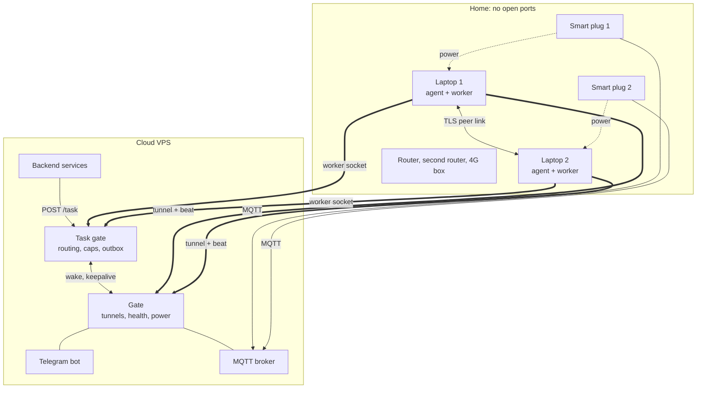
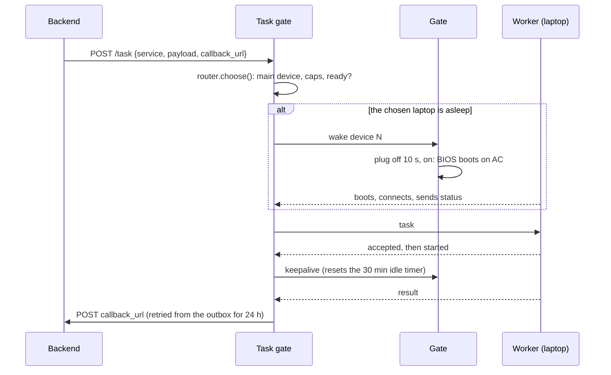
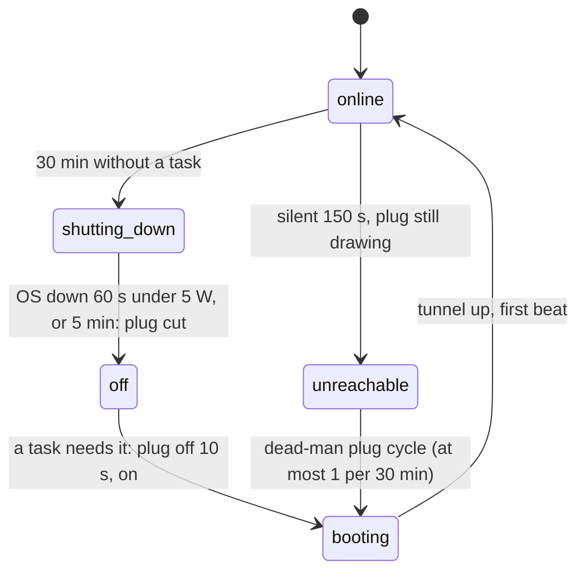

# Local VPS

**Two ordinary home laptops, run like servers from the cloud.**

This project turns home Windows laptops into always-on workers that a cloud VPS
controls completely. The laptops dial out to
the cloud, so the home network needs no open ports. They sleep when idle and wake
for work. They restart themselves when they freeze, switch internet lines when
one dies, and report everything to a Telegram bot.

- **Write-up** (every part and algorithm): [docs/WRITEUP.md](docs/WRITEUP.md)
- **Project page:** <https://ahmednassem.com/projects/localvps>
- **Slides:** <https://ahmednassem.com/webslides/p/local-vps>

## Why

Some automation can't run in a data center. It needs a real Windows desktop,
real browsers, and an ordinary home internet connection. Home laptops give you
that, but none of what makes a server manageable: remote power, a way in with
no open ports, failover when a line dies, and someone to notice when a machine
hangs. Local VPS builds those parts, so the laptops can be run like servers.

## What's in the box

| Folder | Runs on | What it does |
|---|---|---|
| [`cloud/`](cloud) | the cloud VPS (Linux) | The **gate**: device tunnels, heartbeats, the health-case engine, dead-man switch, idle sleep / wake, smart-plug control over MQTT, network rotation policy, Telegram admin bot, admin and output APIs |
| [`taskgate/`](taskgate) | the cloud VPS | The **task gate**: takes tasks from your backend, picks a laptop (caps, shifts, wake, retry rules) and returns results to a callback, with an encrypted, persistent outbox |
| [`agent/`](agent) | each Windows laptop | A native **Windows service** (LocalSystem, auto-start): control tunnel, telemetry, network failover across three uplinks, router reboots with an interlock, peer link to the other laptop, overheat kill switch, remote-desktop watchdogs |
| [`examples/`](examples) | anywhere | `echo_worker.py`: a minimal worker that speaks the task-gate protocol, so the whole pipeline runs on one machine |

The real workers are not part of this repo. Any
program that speaks the worker protocol in [`examples/echo_worker.py`](examples/echo_worker.py) can plug in.

## Architecture



Everything at home connects **out**. The cloud never needs to reach in, and the
home router stays closed.

## How a task flows



## The health engine

Every 30 seconds the gate gives each laptop one **health case**. It combines the
laptop's own beat, what each smart plug reports over MQTT, and what both laptops
see of the home network. Only some cases act.

| Case | Meaning | Action |
|---|---|---|
| 0 | Waiting for data (just after a restart) | none |
| 1 | Normal | none |
| 2 | 4G backup down, router fine | shown in the report |
| 3 | Home router down, running on 4G | **hold** all power rules |
| 4 / 4b | Plug not answering (4b: on battery too) | hold |
| 5 | Laptop silent while its plug draws power: hung | **dead-man**: cycle the plug |
| 6 | Laptop off | none |
| 7 | Laptop off but plug still on | cut the plug |
| 8 | Laptop booted by itself, plug off | switch the plug on |
| 9 | Cloud can't see it, the other laptop can | hold and alert, never cycle |
| 10 | Laptop and plug both silent: home offline | hold and alert |
| 11 | House power out: router down, on battery | hold; clean shutdown at 15 % |

**Power is never cut while a laptop is "running"** (it has a tunnel, or the
other laptop sees it over the peer link).

### Power without buttons



The BIOS is set to *power on when AC returns*, so "plug off, then on" is the
same as pressing the power button. That works even on a fully frozen machine.

## Networks: three lines, one radio

Each laptop can reach the internet three ways: the main router's Wi-Fi, a second
router on the Ethernet cable, and a 4G box (its hotspot, with USB tethering as a
fallback). Each one has its own public IP.

- **Failover / failback** run against a *home path* the user chose. Automatic
  moves never overwrite that choice.
- **Rotation** (optional): 20 jobs per line, leave early after 3 failed jobs in
  a row, never switch while work is in flight, skip a dead line for 50 jobs.
- **Router reboot interlock**: to get a fresh IP, a box is rebooted only after
  the laptop has moved to a line that survives it. The reboot is refused if that
  line has no internet, and two reboots never run at once.

## Security model

- Laptops authenticate with a shared token; the gate's admin API listens only on
  loopback with an admin key; the Telegram bot answers a single admin user ID.
- Agents try the domain first (a real certificate). If that fails, they use the
  bare IP with the gate's **self-signed certificate pinned by SHA-256**.
- The two laptops talk over TLS with pinned self-signed certificates and a shared
  cluster token.
- Live tasks and undelivered results are saved to disk **encrypted** (Fernet), so
  a gate restart loses nothing.
- Smart plugs run open firmware (OpenBeken) and talk to *your* MQTT broker. No
  vendor cloud is involved.

## Setup

Everything is configured through `.env` files. Each folder has a `.env.example`
with every setting explained. Nothing about a specific network is hard-coded.

**Cloud VPS** (Ubuntu, Python 3.11+):

```bash
cd cloud && python3 -m venv venv && venv/bin/pip install -r requirements.txt
cp .env.example .env    # bot token, admin id, AGENT_TOKEN, ADMIN_KEY, MQTT login
sudo cp localserver-gate.service /etc/systemd/system/ && sudo systemctl enable --now localserver-gate

cd ../taskgate && python3 -m venv venv && venv/bin/pip install -r requirements.txt
cp .env.example .env    # WORKER_TOKEN, ADMIN_KEY, TASKS_KEY, POWER_GATE_URL/KEY
sudo cp taskgate.service /etc/systemd/system/ && sudo systemctl enable --now taskgate
```

Put nginx in front for TLS and expose only `/agent/ws`, `/status` (gate) and
`/ws/worker` (task gate). Install Mosquitto with a password file for the plugs.

**Each laptop** (Windows 10/11, Python 3.11 to 3.13, elevated PowerShell):

```powershell
cd agent
copy .env.example .env      # DEVICE_ID, GATE_IP / domain, AGENT_TOKEN, Wi-Fi names, router logins
.\install.ps1               # installs deps, registers the LocalServerCore service, logon task
```

Set the BIOS to power on when AC power is restored.

**Smart plugs:** flash OpenBeken, set the MQTT host, user, password and topic
(`plug1`, `plug2`), and give each a fixed DHCP lease. Then set the same
values in both `.env` files.

**Try the task pipeline locally:** start `taskgate` (`uvicorn main:app --port 8080`),
run `examples/echo_worker.py`, then `POST /task` with `{"service": "echo", ...}`.

## Tests

Plain scripts, no framework needed. Run any `test_*.py` in a folder, for example:

```bash
cd cloud && for t in test_*.py; do python "$t"; done
cd taskgate && python _itest_gate.py   # full gate against fake workers
```

## License

MIT. See [LICENSE](LICENSE).
