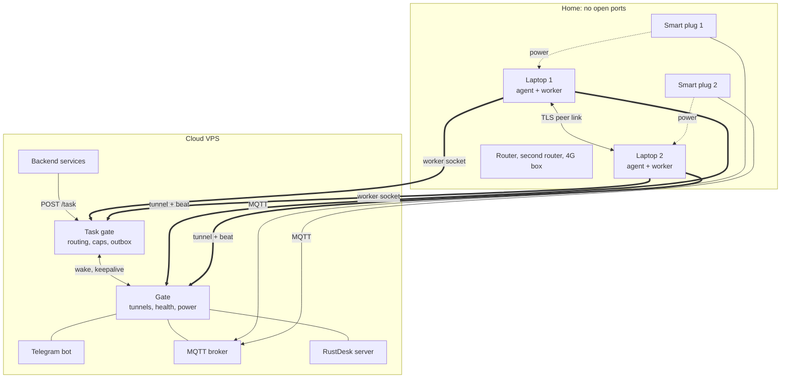
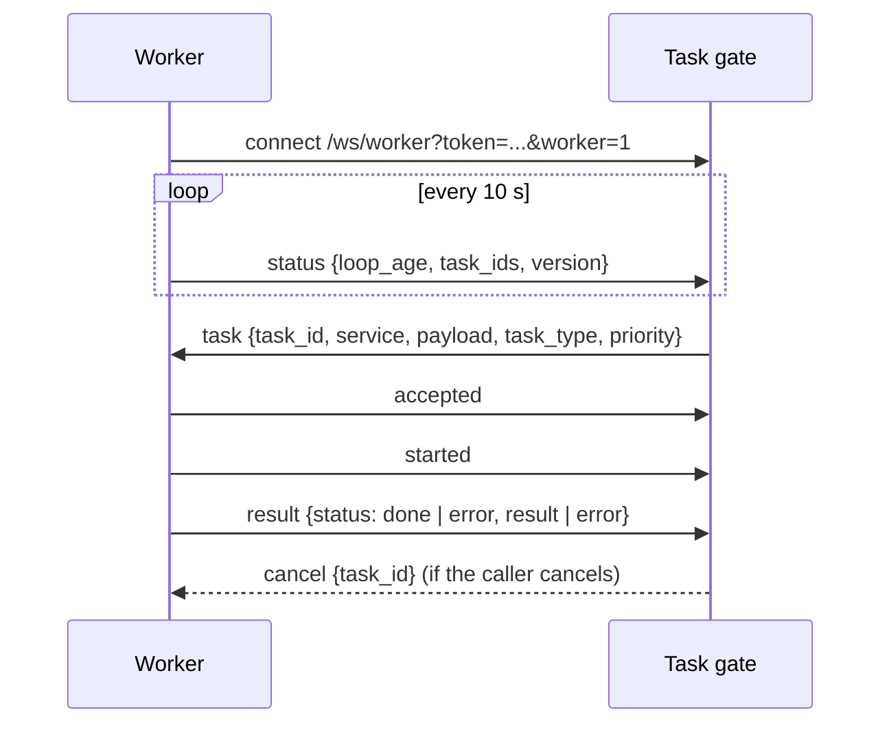
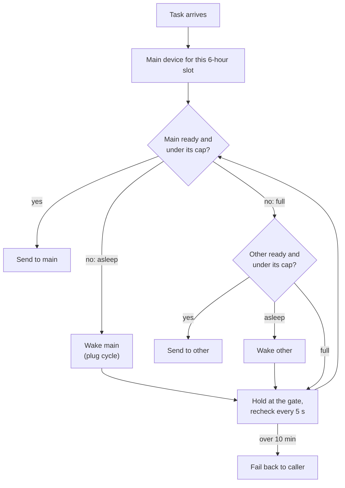
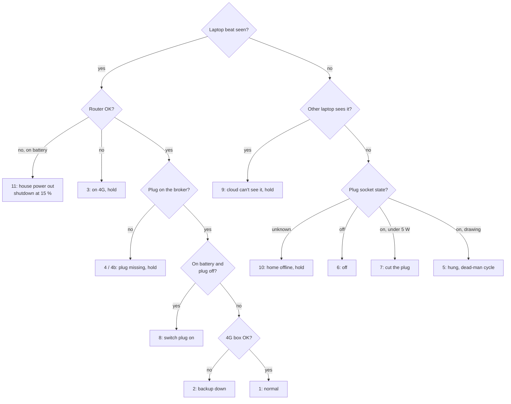
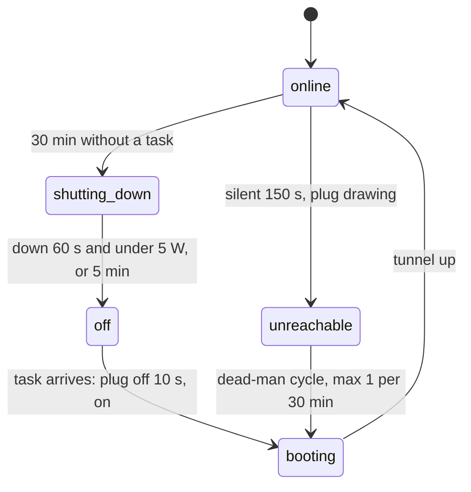
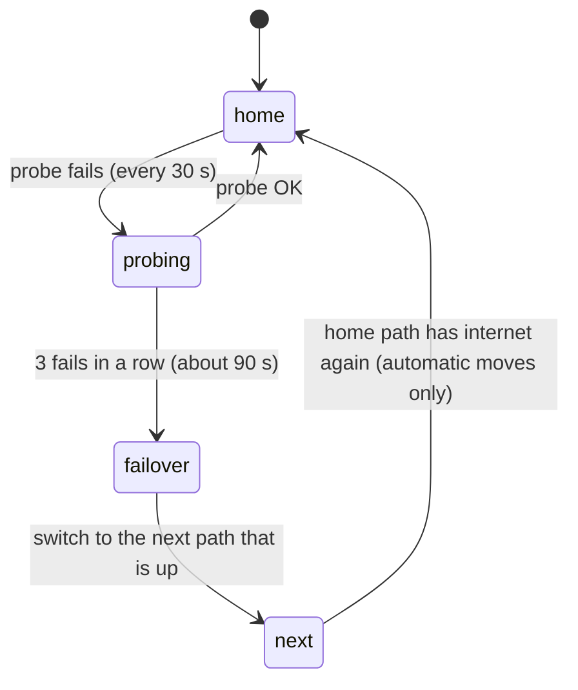
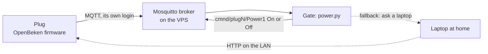
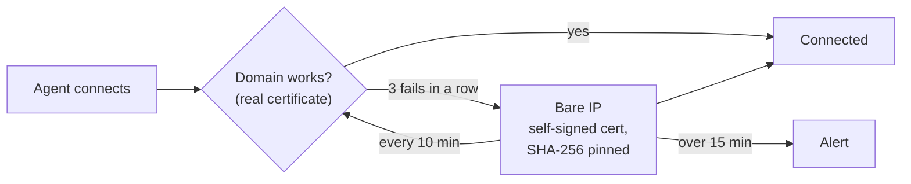

# Local VPS : Full Technical Write-Up
## Two Home Laptops, Run Like Servers From the Cloud

**Version:** 1.0
**Author:** Ahmed Nassem
**Date:** October 2026

---

## Table of Contents

1. [Overview](#1-overview)
2. [Why Home Laptops](#2-why-home-laptops)
3. [System Architecture](#3-system-architecture)
4. [The Laptop Agent : A Windows Service](#4-the-laptop-agent--a-windows-service)
5. [The Gate : The Cloud Side](#5-the-gate--the-cloud-side)
6. [The Task Gate : Which Laptop Does the Work](#6-the-task-gate--which-laptop-does-the-work)
7. [The Health Engine](#7-the-health-engine)
8. [Power Without Buttons](#8-power-without-buttons)
9. [Three Internet Lines](#9-three-internet-lines)
10. [The Peer Link and the Lead Laptop](#10-the-peer-link-and-the-lead-laptop)
11. [Smart Plugs : From a Vendor Cloud to Our Own Broker](#11-smart-plugs--from-a-vendor-cloud-to-our-own-broker)
12. [Remote Desktop](#12-remote-desktop)
13. [Reaching the Gate : Domain First, Pinned IP Second](#13-reaching-the-gate--domain-first-pinned-ip-second)
14. [Security Model](#14-security-model)
15. [Problems and Fixes](#15-problems-and-fixes)
16. [Tools](#16-tools)
17. [Testing and Safe Deployment](#17-testing-and-safe-deployment)
18. [Design Decisions](#18-design-decisions)
19. [Honest Limits](#19-honest-limits)
20. [Future Work](#20-future-work)

---

## 1. Overview

Local VPS turns ordinary home Windows laptops into servers that a cloud VPS controls
completely. The laptops do the work; the cloud VPS decides everything else: which laptop gets each task, when
a laptop sleeps, when it wakes, when its power is cut, which internet line it uses,
and when something is wrong enough to tell a human.

Nobody presses a button at home. A laptop that has nothing to do shuts itself down.
When a task arrives, a smart plug switches its power off and on, and the BIOS boots it
because AC power came back. A laptop that freezes gets the same treatment. When the
home router dies, the laptop moves to a 4G box. When the cloud itself can't be
reached, one laptop takes over a few of the rules at home.

The whole system is three Python programs:

- **the gate** on the cloud VPS: tunnels, health, power, network policy, Telegram bot;
- **the task gate** on the cloud VPS: task routing between the laptops;
- **the agent** on every laptop: a native Windows service that obeys the gate.

---

## 2. Why Home Laptops

The workers need a real Windows desktop with real browsers, on the home's own
internet lines. So the work runs *at home*, but it still has to be managed like a
server: always reachable, observable, restartable, and cheap.

A home laptop is a surprisingly good server for this:

- it has a **battery**, so it is its own UPS;
- it has **Wi-Fi and Ethernet**, so it can use more than one internet line;
- it costs nothing extra, and it can **sleep** when there's no work.

The hard parts are the things a data center gives you for free: remote power, a
stable network, a way in that needs no open ports, and someone to notice when it
hangs. This project builds those parts.

---

## 3. System Architecture

**Every connection starts at home and goes out.** The home router has no open ports.
The cloud never dials in; it pushes commands down tunnels the laptops opened.

| Part | Where | Role |
|---|---|---|
| Gate | cloud | device tunnels and heartbeats, health, power, network policy, bot, admin API |
| Task gate | cloud | takes tasks from backend services, picks a laptop, returns results |
| Agent | each laptop | Windows service: tunnel, telemetry, failover, router reboots, peer link, watchdogs |
| Worker | each laptop | runs the tasks in real browsers (not part of the public repo) |
| Smart plugs | home | remote power and power metering for each laptop, over MQTT |

---

## 4. The Laptop Agent : A Windows Service

The agent is a native Windows service (pywin32) that starts at boot as
**LocalSystem**, at high priority, with a crash-restart policy. One asyncio runtime
hosts every loop:

- the **control tunnel** and the **status beat**;
- the **network watchdog** (failover and failback) and the router manager;
- the **power watch** (AC unplugged / restored, with battery %);
- the **overheat kill switch**, which shuts down cleanly when the hottest sensor stays
  too hot, without needing the cloud;
- **remote-desktop watchdogs** for AnyDesk and RustDesk;
- the **resume watcher** (wake and login recovery);
- the **peer link**, the **lead fallback**, and a loopback API for the worker.

### Two channels out

1. `POST /status` about every 60 s over HTTPS: telemetry and the dead-man heartbeat.
2. `wss://…/agent/ws`, always connected: commands pushed instantly, results returned on
   the same socket, critical events pushed up.

The first frame on the WebSocket is a `hello` with the device id and the agent token.
Telemetry is built so it **never raises**: a probe that fails reports `null`.

### Session 0

A service has no desktop. To show a window or start remote desktop *on the user's
screen*, the agent takes the active console user's token (`WTSQueryUserToken`) and
calls `CreateProcessAsUser` into that session. For apps that must run elevated, it
falls back to a one-shot scheduled task with the highest run level, which needs no UAC
prompt when started by LocalSystem. Before login, it waits for a usable session and
retries.

### The UI can't switch networks, so it asks

The small status window runs in the user's session, where changing route metrics is
"Access Denied". It drops a request file; the elevated service applies the switch and
writes the result back.

---

## 5. The Gate : The Cloud Side

The gate is one FastAPI process under systemd. It **holds no business logic**: it
checks auth, moves frames, and hosts one instance per device of each policy module:

| Module | Job |
|---|---|
| `health` | one health case per device every 30 s |
| `cluster` | one node state per device (online, booting, shutting_down, off, unreachable) |
| `alerts` | warnings and the dead-man plug cycle |
| `night` | idle shutdown and wake-on-task |
| `vps_power` | intentional off / on, plug cut after shutdown |
| `netrotate` | when to move a laptop to another internet line |
| `homenet` | main router and 4G box state, from what laptops and plugs see |
| `power` | the smart plugs over MQTT, with a laptop as fallback |
| `cfwatch` | keeps the DNS records right through the Cloudflare API |
| `bot` | single-admin Telegram bot |
| `scheduler` | cron-style jobs from a JSON file |

The admin API listens on loopback only and needs an admin key. A separate read-mostly
"output API" feeds the admin web pages.

---

## 6. The Task Gate : Which Laptop Does the Work

Backend services on the VPS `POST /task` with a service name, a payload and a callback
URL. The task gate chooses a laptop, sends the task down that laptop's worker
WebSocket, and posts the result to the callback.

### The worker protocol

A newer connection from the same worker replaces the old one (close code 4409). A bad
token is refused (4401). `examples/echo_worker.py` in the repo is a complete worker in
about 100 lines.

### The routing algorithm

Every service belongs to a **type**, and the rules live on the type, not the service:

| Type | Place | Wake | Retry |
|---|---|---|---|
| login | fill_main | yes | bounce to the other laptop |
| payment | fill_main | yes | none (never runs twice) |
| lookup | online_only | no, if another is online | other laptop once |
| action | least_busy | yes | other laptop once |
| test | least_busy | never | none |

- **Main swap:** the main device changes every 6 hours (00, 06, 12, 18 local time), so
  each laptop gets rest.
- **Caps** per device and per cap group, for example 5 logins at once.
- **Ready** means a worker is connected with a fresh status and a live task loop. A
  connection that still answers but whose loop has frozen is *not* ready.
- **Wake timeout:** if a woken device isn't ready in 240 s, the other one is tried. At
  most one wake every 3 minutes per device.
- **Disconnect grace:** a dropped connection gets 20 s before its tasks move.
- **Never run twice:** a task moves to the other laptop only if it hasn't started.
  Money tasks are never re-run once started.

### Nothing is lost on restart

Live tasks are saved to disk **encrypted** (Fernet). Results that can't be delivered
yet go into an **outbox** and are retried for 24 hours. A gate restart picks up where
it left off.

---

## 7. The Health Engine

Every 30 seconds the gate turns three kinds of evidence into one **health case** per
laptop:

- the laptop's own beat (missing after 180 s): uplink, AC, battery, and its LAN view of
  the router and both plugs;
- each plug's MQTT state (missing after 180 s);
- the home network state, from both laptops and both plugs.

Three rules make the cases safe:

1. **Hold beats action.** When the evidence is unclear (router down, plug missing,
   cloud can't see the laptop but the other laptop can), the power rules stop.
2. **Never cut a running laptop.** A laptop with a tunnel, or one the other laptop sees
   over the peer link, is "running", and no power rule may cut it.
3. **No flapping.** An alert goes out when a case starts and when it ends, at least
   10 minutes apart per device.

On top of the cases, `cluster.py` keeps a node state per device (online, booting,
shutting_down, off, unreachable) for the API and the bot.

---

## 8. Power Without Buttons

The BIOS on each laptop is set to **power on when AC power returns**. So "plug off for
10 s, then on" is the same as pressing the power button, and it works on a completely
frozen machine.

### Idle shutdown and wake

- The task gate pings `keepalive` for every task and result. After **30 minutes**
  without one, the gate shuts the laptop down through the agent and marks it
  *intentional offline*, so the dead-man won't revive it.
- The plug is cut only after the control link has been gone for 60 s **and** the draw
  is under 5 W, or 5 minutes have passed (a laptop that is off still charges its
  battery). If the laptop is somehow still up after 15 minutes, the cut is abandoned.
- A task for a sleeping laptop calls `wake`: plug cycle, 300 s boot grace.
- Measured live: wake call to OS up in about 13 s, worker connected in about 33 s;
  shutdown to plug off in about 1.5 to 2 minutes.

### The dead-man switch

If a laptop stops beating for 150 s while its plug still draws power, it is hung
(case 5). The gate power-cycles its plug, at most once every 30 minutes, and reports
when it comes back.

### Odd cases that turned into rules

- A laptop **booted by itself** on battery (a BIOS clock rule): case 8 switches its plug
  on.
- **House power out:** router down and on battery. Hold everything, and shut down
  cleanly at 15 % so the disk is safe.

---

## 9. Three Internet Lines

Each laptop can use three lines, each with its own box and its own public IP:

| Path | Box | Notes |
|---|---|---|
| `wifi` | main DSL router | the default |
| `eth` | a second router on the cable | always up during Wi-Fi changes |
| `sms` | a 4G box | its hotspot first, USB tethering as fallback |

The laptop has **one Wi-Fi radio** shared by `wifi` and `sms`, so switching between them
is a re-association of about 10 s. Windows must never roam between the two networks on
its own: the hotspot profile is set to manual connect, and only the agent moves the
radio.

### Failover and failback

- The probe is a TCP connect *through the current interface* with a 4 s timeout.
- Switches change interface **and** route metrics (Windows adds them together).
- Failback goes to the **home path the user chose**. Automatic moves never save a
  preference. That one rule fixed a bug where a 4G blip silently converted "stay on 4G"
  into "Wi-Fi" forever.

### IP rotation (built, currently off by a flag)

The worker reports the outcome of every job (done, rejected, failed). The
gate decides when to move:

- a **stint** is 20 attempts on one path, then the next path in `wifi → eth → sms`;
- **3 rejected in a row** rotates early;
- never switch while work is in flight; wait for idle, but force after 300 s;
- 300 s cooldown between rotations;
- a dead path is skipped for a 50-attempt penalty;
- a Telegram summary every 100 attempts.

### The reboot interlock

A router reboot gives a new IP, but it also cuts off anyone using that router. Every
caller goes through one function that:

1. refuses if another reboot is running;
2. moves the laptop to a **surviving** path first;
3. refuses if the survivor has no internet;
4. pauses the network watchdog during the reboot, then restores the old path.

---

## 10. The Peer Link and the Lead Laptop

The two laptops keep a direct **TLS link** over the home LAN:

- the lower device id dials, the other listens;
- each side has its own self-signed certificate; the dialer **pins** the listener's
  fingerprint, and both sides prove a shared cluster token;
- frames are JSON lines: `hello`, `beat` every 5 s (dead after 20 s of silence), and
  `msg` / `reply`;
- the laptops find each other with a UDP beacon every 10 s, then a hint pushed by the
  cloud, then a fixed address.

The peer link powers case 9 ("the cloud can't see it, but its neighbour can") and a
**task handoff**: one laptop's worker can claim a task waiting for the other, and the
gate moves it only if it hasn't started.

### When the cloud is gone

If neither laptop has reached the cloud for 300 s, the shift laptop becomes the
**lead** and runs a few rules at home:

- shut down the other laptop after 30 idle minutes (no task can arrive anyway);
- cut that laptop's plug once it's down;
- switch its own plug on if it runs on battery with the plug off.

Every action goes to a local log, which is sent to the cloud as one event when it
comes back.

---

## 11. Smart Plugs : From a Vendor Cloud to Our Own Broker

### Version 1: the vendor cloud

The plugs were first switched through the vendor's cloud API. It worked until the free
trial quota ran out: about **26k calls a month** were allowed, against about **86k**
needed to read two plugs every minute. Then a missing plug held every power rule.

### Version 2: open firmware and MQTT

- Each plug connects **out** to the broker, through the router's Wi-Fi, or the 4G
  box's Wi-Fi as a backup. The cloud can read and switch it even with both laptops off.
- Each plug has its own broker login and may only touch its own topics.
- The gate reads the connected flag, the relay state, the Wi-Fi it is on, and the
  power meter (watts, volts, current).
- If a plug isn't on the broker, the gate asks a laptop at home to switch it over the
  local network.
- The provider's firewall blocked the MQTT port, so the plugs connect on another port
  and the VPS redirects it to the broker. The redirect was lost on reboot, so a small
  boot service re-adds it.

Flashing, at a high level: an open-source tool replaced the firmware over Wi-Fi. A
generic pin profile was wrong (no power at the socket), so the real pin map was read
from the plug's own stored factory settings: relay, button, LED, a night lamp, and the
power meter. Plug 2 went first and was tested by hand, then plug 1, then the cutover.

### Plugs as network sensors

Because a plug reaches the cloud through *either* Wi-Fi, **which** Wi-Fi it uses says
what is broken at home. `homenet.py` combines what both laptops and both plugs report:

| State | Evidence |
|---|---|
| Main router down | a plug moved to the 4G Wi-Fi, or a laptop can't reach the router or see its Wi-Fi |
| Router up, no internet | a laptop reaches the router but has no internet through it |
| 4G box down | a laptop says the box is gone |
| Home unreachable | no laptop beat and no plug on the broker |

"OK" evidence beats "down" evidence, a state must hold 90 s before it is announced, and
every alert has a matching "back to OK".

---

## 12. Remote Desktop

AnyDesk came first. Its free tier throttled sessions, showed nag popups and dropped
connections, and the RustDesk client used a public relay on another continent. So a
**self-hosted RustDesk server** (ID server plus relay, two systemd units)
went up on the VPS. Clients without the server's public key are refused, so the open
ports are useless to strangers.

On the laptops, RustDesk became a managed component next to AnyDesk:

- a watchdog every 15 s: not running, start it elevated; running but not elevated,
  restart it elevated;
- detection runs **in the user's session**, because background processes in Session 0
  make it look "running" when it isn't;
- the ID is pinned in the config, because `--get-id` returns nothing under SYSTEM;
- bot commands, a `/status` line, edge-triggered alerts and a morning start.

Lesson from the DNS migration: remote access is the emergency path, so it points at
the raw IP and depends on neither DNS nor a CDN.

---

## 13. Reaching the Gate : Domain First, Pinned IP Second

- The domain has a Let's Encrypt certificate (DNS-01, so port 80 isn't needed).
- On the IP, the gate's self-signed certificate is pinned by fingerprint. Commands only
  travel on the pinned channel.
- `cfwatch.py` checks the DNS records every 10 minutes through the Cloudflare API and
  through public resolvers, repairs a wrong record, and alerts.
- Machine tunnels stay **DNS-only**: a CDN proxy would kill long-lived WebSockets, and
  its bot check once blocked the status beats for 10 minutes (Python's default
  User-Agent).

---

## 14. Security Model

- **No inbound ports at home.** Everything dials out.
- **Tokens everywhere:** an agent token for the tunnels, a worker token for the task
  gate, a cluster token for the peer link, and separate admin keys for the loopback
  APIs.
- **Pinned certificates** for the IP fallback and the peer link.
- **One admin.** The Telegram bot ignores everyone except one user ID.
- **Loopback-only admin APIs**, plus a per-service loopback firewall on the VPS.
- **Encrypted state:** the live-task file (Fernet) and the worker's saved queue
  (Windows DPAPI).
- **No vendor cloud** for power: the plugs talk only to our broker, with per-plug logins
  limited to their own topics.
- **Secrets stay out of logs:** HTTP client logging was silenced after it wrote a bot
  token into the journal.
- **Everything is in `.env`.** Nothing about a specific network is hard-coded.

---

## 15. Problems and Fixes

A selection from more than a hundred logged problems. Each one changed the design.

| Symptom | Real cause | Fix |
|---|---|---|
| Browsers opened by the service were invisible | Services run in Session 0, with no desktop | Launch into the user's session; worker runs as a logon task |
| Wake from sleep never detected | Windows' monotonic clock stops during sleep | Detect wake from wall-clock gaps |
| The 4G path always showed "off" | `netsh` only lists the current network while connected | Forced scans through the native WLAN API; 1 result counts as "unknown" |
| "Ethernet" was really the 4G box | Its USB link looks like a second Ethernet adapter | Ethernet means the cable NIC only |
| Choosing 4G kept reverting to Wi-Fi | An automatic failover saved its choice | A "home path"; automatic moves never save |
| USB tethering didn't move traffic | Windows adds route and interface metrics | Set both |
| The router "reboot" did nothing | The URL was a progress page; its script made the real call | Call the real endpoint; back in 76 s with a new IP |
| Router admin locked us out | Single-user sessions tracked by source IP | Always log out |
| Tasks stuck for 35+ minutes | Retry budget started late and outlived the caller | Start the clock at enqueue |
| Six tasks "running", none ran | The task loop crashed, the socket kept acking | Loop survives errors; `started` frame; loop heartbeat |
| Task waited 3 min after its laptop was ready | Held tasks were only rechecked on connect | 5 s recheck timer |
| Second worker knocked the first off | One global worker connection | One connection per device |
| Laptop 2 idle all night | Wake and keepalive calls didn't name a device | Device-aware calls |
| RustDesk kept disconnecting | A "connect" ran every 20 s even when connected | Idempotent switch |
| Agent "kept restarting" | A session check that doesn't work on Windows; retry work counted as sleep | Fixed both checks |
| Laptop 2 crashed at startup | Python on Windows ships without tzdata | Fixed-offset fallback plus tzdata |
| Beats blocked after enabling the CDN | Bot check rejected Python's User-Agent | Custom User-Agent; machine hosts DNS-only |
| Laptops never slept | Plug vendor quota ran out, plugs "missing", hold | Open firmware, own MQTT broker |
| MQTT port redirect lost on reboot | It was a runtime rule only | A small boot service re-adds it |
| A module shrank to 2 bytes | A file sync truncated it | Hash-compare against live copies before deploy |
| `/api/status` returned 500 | `Infinity` isn't valid JSON | Serialize as `null` |
| Bot token in the system journal | HTTP client INFO logging printed URLs | Silence that logger |

---

## 16. Tools

| Area | Tools |
|---|---|
| Language | Python 3 with asyncio, one runtime per process |
| Cloud | Ubuntu, systemd, nginx, Let's Encrypt (certbot DNS-01), nftables |
| Web | FastAPI, uvicorn, websockets, httpx, aiohttp, pydantic |
| Windows | pywin32 service, psutil, WMI, PowerShell, netsh, the native WLAN API, Task Scheduler, `CreateProcessAsUser` |
| Messaging | Telegram Bot API (python-telegram-bot) |
| Power | OpenBeken firmware, Mosquitto MQTT, paho-mqtt; the vendor cloud API before that |
| DNS | Cloudflare API and proxy |
| Remote desktop | RustDesk (self-hosted), AnyDesk |
| Crypto | self-signed EC certificates with SHA-256 pinning, Fernet, Windows DPAPI |
| Storage | JSON and JSONL files, SQLite on the VPS with nightly backups |
| Building | Git, Mermaid, Webslides for the deck |

---

## 17. Testing and Safe Deployment

- **Tests are plain scripts** (`test_*.py`) that run without a framework: router rules
  (41 cases), the full task gate against fake workers (21 checks), the peer link, the
  gate link, DNS watch, plug control, plug-cut timing, health cases and network
  rotation.
- **Drills** pretend one input is bad for a while (a plug missing, the 4G box off) on
  the live system, and prove the reaction without breaking anything.
- **Deploying** follows one order every time:
  1. snapshot the live code and settings (the rollback point);
  2. run every test locally;
  3. run them again in a scratch copy on the VPS;
  4. the gate first, then laptop 2, then laptop 1, one file at a time;
  5. verify live: plugs online, both laptops normal, zero errors in the logs.
- A **version hash** of each agent's code lets the gate and the other laptop see when
  the two laptops run different code.

---

## 18. Design Decisions

- **Dial out, never in.** No open ports, no dynamic DNS, no router configuration.
  The cost is that the cloud must be up for commands; the lead fallback covers the
  essentials when it isn't.
- **Policy in the cloud, obedience at home.** Rules live in one place and change with one
  deploy. Laptops execute.
- **Power is the last resort, and it is careful.** Unclear evidence holds; a running
  laptop is never cut; the dead-man cycles at most once every 30 minutes.
- **A plug is a power button.** With "power on with AC" in the BIOS, one smart plug gives
  remote on, remote off and a hard reset for a few dollars.
- **Rules on types, not services.** A new automation service is one line; its routing
  comes from its type.
- **Never run a task twice.** Moves only happen before a task starts; money tasks are
  never re-run.
- **Own the dependencies that hold power.** The vendor quota showed that a power switch
  can't depend on someone else's free tier.

---

## 19. Honest Limits

- **Two laptops, one house.** A house-wide power or internet cut stops everything; the
  system can only notice it, hold, and shut down cleanly.
- **One cloud VPS.** If it is down, tasks can't arrive; the lead laptop only keeps
  power sane.
- **Windows-specific agent.** The agent depends on pywin32, WMI and Windows networking.
- **Hardware moods.** The 4G box turns its Wi-Fi off after minutes without clients, and
  its USB adapter flaps on its own. Software can work around this, not fix it.
- **IP rotation is off.** It is built and tested, but it stays off until it is needed
  again.
- **The second router's reboot** is a placeholder; its admin interface was never wired.

---

## 20. Future Work

- Run the agent on Linux mini-PCs as well as Windows laptops.
- A web dashboard built on the output API, instead of only Telegram.
- Generalize the worker protocol into a small published spec with a reference worker in
  more languages.
- More than two laptops: the router and the health engine are already per-device; the
  peer link would need a small mesh.
